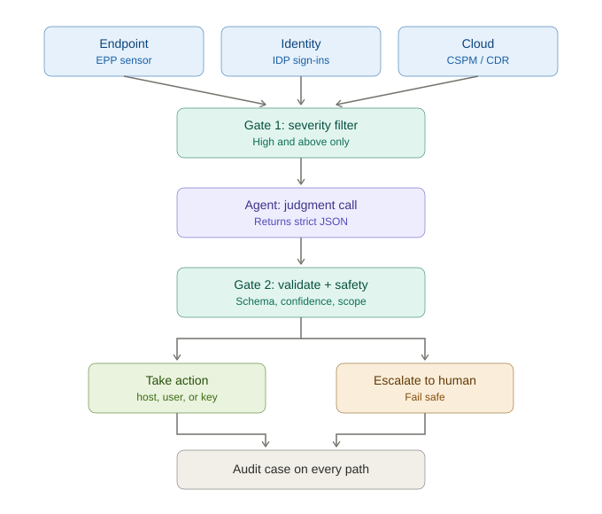
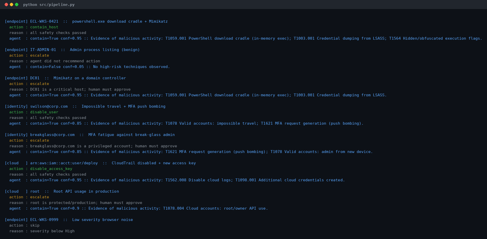
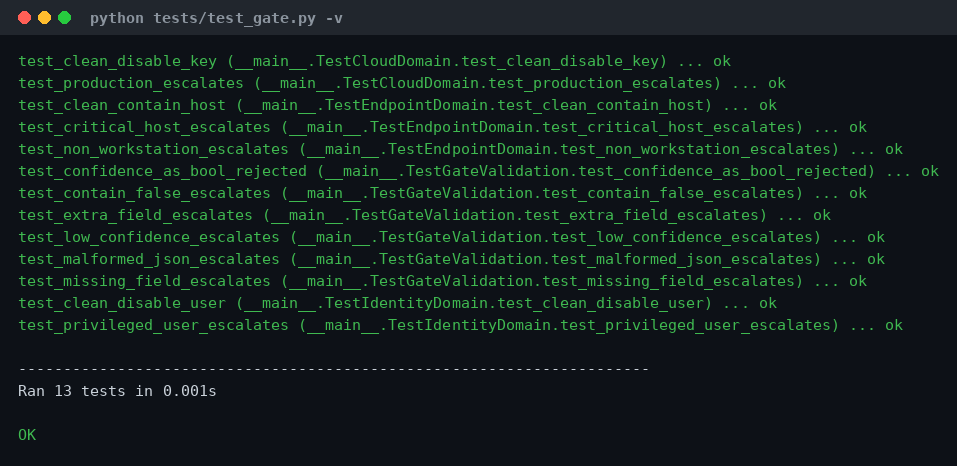

# Agentic SOC: containment triage pipeline

A small, dependency-free Python project that reconstructs the response-workflow
logic from CrowdStrike's "Agentic SOC in Action" workshop (Charlotte AI
AgentWorks + Falcon Fusion). I built it to study how an AI agent can be used to
recommend security response **safely**, with deterministic guardrails around the
agent's judgment, across endpoint, identity, and cloud detections.

This is a learning reconstruction, not a product and not production code. The
"agent" is a deterministic stand-in for an LLM so the project runs with no API
keys.

## Architecture



Core idea: a deterministic "sandwich". Let the agent do only the judgment step,
make it return a strict JSON schema, then treat that output as **untrusted
input**. Deterministic rules decide when the agent runs and what is allowed to
actually happen. Every failure falls toward a human ("fail safe"), never toward
an action.

```
detection (endpoint | identity | cloud)
  -> Gate 1  trigger + severity filter      (deterministic)  src/pipeline.py
  -> Agent   judgment call, returns JSON     (the LLM step)   src/agent.py
  -> Gate 2  validate output + safety rules  (deterministic)  src/gate.py
  -> Action  domain-specific  OR  escalate to human
  -> Case    audit record on every path                       src/pipeline.py
```

## Demo

Pipeline running sample detections across all three domains (green = action taken,
amber = escalated to a human, gray = skipped):



The deterministic gate's unit tests, one per class of bad agent output:



## Three detection domains

The same pattern handles three Falcon detection sources. Only the scoring inputs
and the final action differ; the agent contract and the gate are shared.

| Domain | Example detection | MITRE sample | Action when approved |
|---|---|---|---|
| endpoint | PowerShell cradle + Mimikatz | T1059.001, T1003.001 | `contain_host` |
| identity | Impossible travel + MFA fatigue | T1078, T1621 | `disable_user` |
| cloud | CloudTrail disabled + new access key | T1562.008, T1098.001 | `disable_access_key` |

Each domain also has its own guardrail the agent cannot override:

| Domain | Guardrail (forces human escalation) |
|---|---|
| endpoint | Critical hosts (DCs, payment hosts) and non-workstations |
| identity | Privileged/break-glass accounts |
| cloud | Production or protected resources (e.g. root) |

## What each file does

| File | Responsibility |
|---|---|
| `src/deobfuscate.py` | Normalize obfuscated PowerShell (base64 `-enc`, `'I'+'EX'`, backticks, `[char]`) before matching |
| `src/detections.py` | Behavior-based scoring for endpoint, identity, and cloud, mapped to MITRE ATT&CK |
| `src/agent.py` | Stand-in for the AgentWorks agent; returns `{explanation, confidence, contain}`; can emit bad output to test the gate |
| `src/gate.py` | Deterministic gate: JSON parse, schema check, confidence floor, per-domain safety rules |
| `src/pipeline.py` | End-to-end workflow + audit case creation |
| `schema/containment_output.schema.json` | The agent output contract (from the workshop) |
| `tests/test_gate.py` | Unit tests proving the gate catches each class of bad output, per domain |
| `docs/architecture.svg` | The diagram above |

## Run it

```bash
python3 src/pipeline.py                         # run sample detections end to end
python3 -m unittest discover -s tests -v        # run the gate tests
python3 src/deobfuscate.py                       # see de-obfuscation in action
```

No dependencies. Python 3.9+.

## What the sample run shows

| Entity | Domain | Outcome | Why |
|---|---|---|---|
| ECL-WKS-0421 | endpoint | contain_host | Workstation, high confidence, all checks pass |
| IT-ADMIN-01 | endpoint | escalate | Benign; agent did not recommend action |
| DC01 | endpoint | escalate | Critical host; human approval even when the agent says act |
| swilson@corp.com | identity | disable_user | Impossible travel + push bombing on a normal user |
| breakglass@corp.com | identity | escalate | Privileged account; never auto-disabled |
| deploy (staging) | cloud | disable_access_key | Logging disabled + new key in a non-prod account |
| root (production) | cloud | escalate | Protected/production; human must approve |

## Design notes and deliberate hardening

Added on top of the workshop because the lab version left them open:

- **Confidence floor.** The workshop schema has no range on `confidence` and the
  Fusion workflow never checks it. `gate.py` enforces a minimum before any action.
- **Per-domain blast radius.** Critical hosts, privileged users, and production
  cloud resources are never auto-actioned regardless of the agent's verdict.
- **Strict schema.** `additionalProperties: false` plus type checks, so an agent
  that invents a field is rejected.
- **De-obfuscation before matching.** Behavior survives text rewriting, so the
  normalizer decodes `-enc` and friends first.

## Known limitation (honest)

The gate only stops unsafe **actions** (acting when it should not). It does not
catch a false negative, where the agent says `contain: false` on a real
compromise, for example via prompt injection in a command line. Mitigations
worth adding: log every decision to a case (done), spot-check "no-action"
verdicts, run evals against known-bad detections, and force escalation from a
high-confidence deterministic rule regardless of the agent's verdict.

## Background

Built after completing CrowdStrike's hands-on Agentic SOC workshop, to turn the
concepts (AgentWorks agents, grounding, structured output, Fusion gating) into
working code I could reason about and test.
